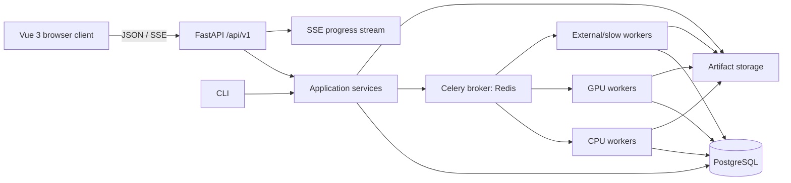

# Architecture

## Goal

Turn the existing Python research pipeline into a reproducible service without changing its scientific semantics by accident.

The system should support:

1. TEI/XML import into immutable dataset snapshots.
2. Independent execution of multiple classification methods.
3. Re-aggregation without rerunning expensive classifiers.
4. Human review and correction.
5. Evaluation and inter-method agreement analysis.
6. TEI/JSON/CSV export with provenance.
7. Local/private operation where data does not leave the editorial environment.

## Logical architecture

## Layer boundaries

### Contracts
Pydantic models define application-facing data structures, configuration, task envelopes, and API schemas.

### Application services
Use-case orchestration: import snapshot, create run, schedule executions, aggregate, annotate, evaluate, export.

### Domain/scientific logic
Normalization, classifier adapters, aggregation, certainty assignment, agreement calculations, TEI mapping.

### Persistence
SQLAlchemy repositories and PostgreSQL. Persistence concerns must not leak into domain contracts.

### Async execution
Celery workers execute method batches, aggregation/evaluation jobs, and exports. Workers call application/domain services directly.

### Artifact storage
Original TEI, exported TEI, model artifacts, cached local datasets, large raw outputs, and generated reports are referenced by checksummed artifact records.

### Browser client boundary
The planned Vue 3 + TypeScript + Vite UI consumes the public `/api/v1` interface like any other client. It receives domain resources, typed JSON, downloads, and optional SSE progress only. It does not see SQLAlchemy models, Celery task IDs, Redis keys, queue names, worker identities, or filesystem paths. OpenAPI is the machine-readable transport contract. See `17-frontend-integration.md`.

## Initial deployment topology

One Compose project is enough initially:

- `api`
- `worker-cpu`
- `worker-gpu` (optional on machines without GPU)
- `worker-external` (optional)
- `postgres`
- `redis`
- `frontend` (Vue static build once Phase 6 begins)
- reverse proxy (same-origin `/` + `/api/v1`)

GPU workers may later run on a separate host while using the same broker/database, subject to network/security constraints.

## Explicit non-goals for v1

- Kubernetes
- Kafka
- one microservice per classifier
- event sourcing
- a workflow engine in addition to Celery
- global entity resolution across projects
- live GND dependency for the reference pipeline
- confidence-weighted voting as default behavior
