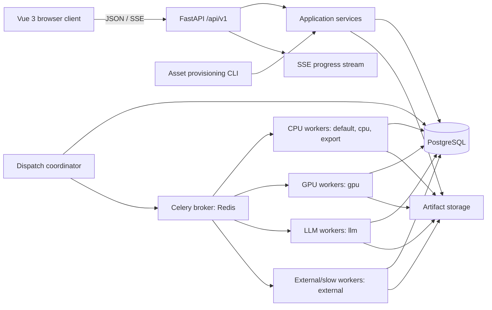

# Architecture

## Goal

Turn the existing Python research pipeline into a reproducible service without changing its scientific semantics by accident.

The system supports:

1. TEI/XML and tabular (CSV/XLSX/JSON) import into immutable dataset snapshots.
2. Independent execution of multiple classification methods.
3. Re-aggregation without rerunning expensive classifiers.
4. Human review and correction.
5. Evaluation and inter-method agreement analysis.
6. TEI/JSON/CSV export with provenance.
7. Local/private operation where data does not leave the editorial environment.

## Logical architecture

## Layer boundaries

### Contracts
Pydantic models define application-facing data structures, configuration, task envelopes, and API schemas.

### Application services
Use-case orchestration: import snapshot, create run, schedule executions, aggregate, annotate, evaluate, export,
and manage account-owned presentation preferences. Personal preferences are separate from project settings,
deployment branding, and scientific configuration; see
[ADR-0043](decisions/ADR-0043-account-level-user-preferences.md).

### Domain/scientific logic
Normalization, classifier adapters, aggregation, certainty assignment, agreement calculations, TEI mapping.

### Persistence
SQLAlchemy repositories and PostgreSQL. Persistence concerns must not leak into domain contracts. The
interfaces that application services require from persistence and storage (repositories, the unit of work,
artifact storage, and persistence errors) live in `gendertagger.services.ports`; `gendertagger.db` and
`gendertagger.storage` implement them.

### Async execution
Application services persist typed work and dispatch intent in PostgreSQL. Every dispatch intent is one row in
the single `dispatch_outbox` outbox table, which references exactly one of five targets — `task_batch`,
`aggregation_execution`, `dataset_snapshot`, `evaluation_execution`, and `export` — enforced by the
`exactly_one_target` check constraint. The dispatch coordinator (`gendertagger.tasks.relay`) leases pending
rows, publishes them to Redis, and marks them published. Celery workers execute dataset-snapshot imports,
method batches, aggregation/evaluation jobs, and exports; workers call application/domain services directly.
API requests never publish Celery tasks. All five targets use the same coordinator and worker topology with
distinct identifier-only task envelopes.

`POST /api/v1/classify` is the one deliberate exception to queued execution: it runs the enabled method
adapters inside the API process over a bounded list of submitted names and persists no Prediction. See
[ADR-0028](decisions/ADR-0028-synchronous-on-demand-classification-api.md).

The snapshot-upload request is responsible only for durably staging the bounded source collection and
atomically persisting its member provenance, pending DatasetSnapshot, and outbox intent. Parsing and
PersonRecord persistence happen in the worker after the `202 Accepted` response. The import registry supports
single, loose, ZIP, and TAR.GZ TEI sources plus single CSV, XLSX, and JSON sources through explicit versioned
format, packaging, and profile contracts. See
[ADR-0020](decisions/ADR-0020-asynchronous-snapshot-import-outbox.md) and
[ADR-0021](decisions/ADR-0021-versioned-multi-format-snapshot-ingestion.md).

### Artifact storage
Original input files and bundles, loose-source manifests, export outputs and export manifests, evaluation
reports, run dependency locks, and compiled method assets are referenced by checksummed artifact records. API
and worker processes share the same artifact-storage namespace; the dispatch coordinator does not mount it,
because it only moves identifiers. Task messages carry artifact-owning domain IDs rather than locators or
bytes.

Method data assets use two content-addressed shapes:

- Compiled SQLite lookups (`wiki_gendersort_lookup`, `hivoto_lookup`, `gnd_lookup_snapshot`): one immutable
  database file per artifact, resolved by digest and verified before use. See
  [ADR-0023](decisions/ADR-0023-content-addressed-sqlite-method-lookups.md).
- Model manifests (`hf_distilbert_model_manifest`, `hf_genderize_model_manifest`,
  `hivoto_xgboost_model_manifest`): small JSON artifacts listing the ordered member files that materialize a
  directory-shaped native model, with every member registered as its own artifact. See
  [ADR-0024](decisions/ADR-0024-hf-transformer-model-manifest-adapters.md) and
  [ADR-0025](decisions/ADR-0025-hivoto-xgboost-adapter.md).

The `gendertagger assets` CLI registers source bytes and compiles both shapes. A resolved method configuration
selects its asset by `lookup_sha256`; run scheduling resolves that digest against the method's required
logical type and stores the exact artifact in `MethodExecution.data_artifact_id`.

### Browser client boundary
The Vue 3 + TypeScript + Vite UI consumes the public `/api/v1` interface like any other client. It receives
domain resources, typed JSON, downloads, and optional SSE progress only. It does not see SQLAlchemy models,
Celery task IDs, Redis keys, queue names, worker identities, or filesystem paths. OpenAPI is the
machine-readable transport contract. See `17-frontend-integration.md`.

## Deployment topology

The Compose services, network boundaries, startup order, and host-topology constraints are defined in
[`12-deployment-and-operations.md`](12-deployment-and-operations.md).
