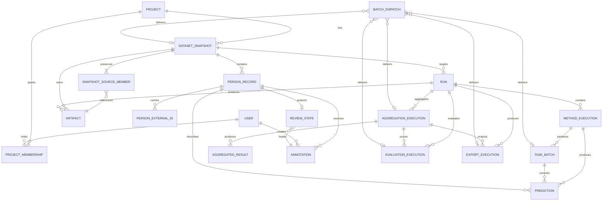

# Domain model

## Identity and immutability

A project represents an editorial/research corpus over time.
Each import creates an immutable `DatasetSnapshot`.

The TEI `xml:id` is the canonical identity of a person **within a project**.
A snapshot stores the state of that canonical project entity at import time.

Logical identity:

```text
(project_id, tei_id)
```

Snapshot occurrence:

```text
(dataset_snapshot_id, tei_id)
```

No global person entity is introduced in v1. GND IDs and other identifiers are external identifiers/evidence, not primary identity.

## Core entities



### Project
Long-lived corpus/editorial project.

### ProjectMembership
One user's role — `viewer`, `reviewer`, or `operator` — in one project. A project owns every snapshot, run,
aggregation, evaluation, and export beneath it, and a user reaches them only through a membership in that
project or the global `admin` role
([ADR-0033](decisions/ADR-0033-project-scoped-membership-roles.md)).

### DatasetSnapshot
Immutable imported state of source data. Stores the primary source or manifest hash, importer/config version,
artifact reference, import timestamp, and record count. Ordered SnapshotSourceMember records preserve each
exact upload's logical name, checksum, size, media type, artifact, and ordinal. For loose TEI collections, the
primary Artifact is also a deterministic immutable manifest; for a single file or archive, the uploaded
Artifact remains primary. A successful asynchronous creation response returns the `pending` snapshot after
its complete source collection and dispatch intent are durable; readiness is observed later through the
resource lifecycle. See [ADR-0020](decisions/ADR-0020-asynchronous-snapshot-import-outbox.md) and
[ADR-0021](decisions/ADR-0021-versioned-multi-format-snapshot-ingestion.md).

### PersonRecord
Normalized projection of one person entry for a specific snapshot. Carries canonical `tei_id`, structured and
flat names, dates, note/context, ordered events, and authority identifiers. It also records the exact
source-member logical name and a format-specific record locator so every projection can be traced to its
source. Records imported before locator provenance was introduced may retain null source locators for
compatibility; method Predictions fingerprint the canonical person input separately.

The stable flat name projection consists of `surname`, ordered `forenames`, and flattened `alt_names`. A
structured-name-aware import additionally preserves ordered direct `<person>/<persName>` forms in
`name_forms`, including whether each form is regular or alternative, its optional subtype, and its direct
`name` or surname/forename components. `name_forms=None` means the importing legacy profile did not capture
that structure; it does not assert that the source contained no name forms. Inline `<persName>` references in
notes or other descriptive content are not person name forms. See
[ADR-0017](decisions/ADR-0017-structured-tei-person-name-forms.md).

The structured forms do not broaden identity: `tei_id` remains the only canonical person identity within a
project. Alternative forenames also do not implicitly become regular-name classification inputs. Ready
PersonRecords, including their flat and structured name projections, remain immutable with their snapshot.

### Run
A reproducible experiment/production execution over exactly one DatasetSnapshot and one fully resolved run configuration.

### MethodExecution
One method inside a Run, with method version/config, queue/resource class, state, progress, errors, and timing.

### Prediction
Immutable output of one MethodExecution for one PersonRecord. Stores normalized label/status plus raw output and method-specific confidence.

### AggregationExecution
A versioned aggregation strategy applied asynchronously to a selected set of completed MethodExecutions.
Re-aggregation creates a new execution instead of modifying predictions. A completed execution owns exactly
one AggregatedResult for every PersonRecord in the run snapshot; a failed execution exposes no partial result
set.

### AggregatedResult
Combined result for one PersonRecord, including final machine label, vote counts, agreement score/tier, certainty tier, and override provenance.

### Annotation
A human editorial decision. Append-only and attributable to a User. May verify, correct, or mark an item for follow-up.

### ReviewState
A mutable concurrency/workflow projection for one PersonRecord in one DatasetSnapshot. Stores the current review revision, current annotation head, and workflow state needed for efficient review queries. It is not a replacement for Annotation history and must be reconstructable from that history.

An annotation command compares `expected_revision` against ReviewState atomically, appends the Annotation, then increments the revision.

### FinalDecision
A derived view, not necessarily a table in v1:

```text
latest valid human annotation
    else selected aggregated result
```

### TaskBatch
One retryable slice of a MethodExecution's person records, carrying its own offset, count, and lifecycle.
The partition is durable, so the executed slicing stays reconstructible even if registry batch sizes change.
Predictions are committed together with their owning batch's completion.

### BatchDispatch
One entry in the transactional outbox. It records the durable intent to publish exactly one unit of
application work to the broker, and each entry points at exactly one of the five dispatch targets:
TaskBatch, AggregationExecution, DatasetSnapshot, EvaluationExecution, or ExportExecution. See
[ADR-0015](decisions/ADR-0015-transactional-batch-dispatch-outbox.md).

### EvaluationExecution
Versioned metrics for one completed AggregationExecution against a defined benchmark/reference set, never
silently against "ground truth". Records the resolved evaluation definition and produces a report Artifact.
Re-evaluating creates a new execution rather than modifying an existing report.

### ExportExecution
A versioned, independently rerunnable projection of one completed AggregationExecution's FinalDecision labels
into TEI, JSON, or CSV output, plus a manifest Artifact recording its inputs and produced outputs. The
`label_source_policy` selects whether the projection reads pure machine aggregation or lets a current human
Annotation override the label (never mutating the underlying Prediction or AggregatedResult). Re-exporting
creates a new execution instead of modifying prior output Artifacts.

### Artifact
Checksummed reference to source XML, exports, manifests, reports, models, or larger payloads.

## Prediction semantics

Canonical label:

```text
male | female | unknown | institution
```

Execution status:

```text
success | abstain | error
```

Rules:

- `success + unknown` means the method evaluated the input and returned an ambiguous/unknown classification.
- `abstain + null label` means the method had no usable basis/input.
- `error + null label` means technical failure.

This distinction is scientifically significant and must be preserved in storage, aggregation, evaluation, and UI.

## State machines

### DatasetSnapshot

```text
pending -> importing -> ready
                   \-> failed
```

The import worker claims a pending snapshot and streams package validation, parsing, PersonRecord writes, and
the ready transition in one transaction. Flushes may bound the write batch, but they do not commit a visible
prefix. A permanent input failure rolls that transaction back before a clean transaction marks the snapshot
failed; a transient failure rolls back to pending for retry. Duplicate delivery cannot reopen a terminal
snapshot.
`ready` is immutable. In this implementation, `importing` exists only inside the worker's open transaction: an
ordinary API reader continues to observe the last committed `pending` state until the transaction commits
`ready`, or until the separate failure transaction commits `failed`. The internal state still enforces
repository write invariants and prevents a competing worker from claiming the same snapshot.

### Run

```text
created -> queued -> running -> completed
                         |       -> completed_with_errors
                         |------> failed
                         \------> cancelled
```

### MethodExecution

```text
pending -> queued -> running -> completed
                         |       -> completed_with_errors
                         |------> failed
                         \------> cancelled
```

### AggregationExecution, EvaluationExecution, ExportExecution, and TaskBatch

All four share one lifecycle:

```text
pending -> queued -> running -> completed
                         |------> failed
                         \------> cancelled
```

Each is independently rerunnable: re-running creates a new execution rather than mutating a terminal one.
An AggregationExecution is the one exception to creating a new one every time: a request identical to a
live or completed aggregation returns that aggregation, because it could only reproduce it. After a failure
or cancellation, the identical request creates a new attempt
([ADR-0034](decisions/ADR-0034-reuse-matching-aggregation-on-creation.md)).

Retries do not create duplicate Predictions for the same execution/person/batch identity.
Aggregation retries likewise do not create duplicate AggregatedResults. A complete input containing explicit
record-level abstentions or errors may still complete; missing required Prediction evidence fails the
AggregationExecution rather than producing a partial or synthetic result.
