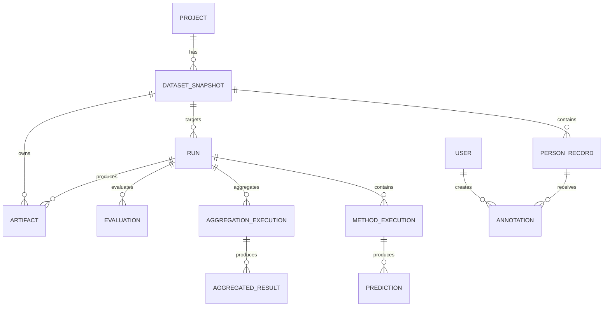

# Domain model

## Identity and immutability

A project represents an editorial/research corpus over time.
Each import creates an immutable `DatasetSnapshot`.

The TEI `xml:id` is the canonical identity of a person **within a project**.
A snapshot stores the state of that canonical project entity at import time.

Logical identity:

```text
(project_id, tei_id)
```

Snapshot occurrence:

```text
(dataset_snapshot_id, tei_id)
```

No global person entity is introduced in v1. GND IDs and other identifiers are external identifiers/evidence, not primary identity.

## Core entities



### Project
Long-lived corpus/editorial project.

### DatasetSnapshot
Immutable imported state of source data. Stores input hash, parser/config version, artifact reference, import timestamp, and record count.

### PersonRecord
Normalized projection of one TEI person entry for a specific snapshot. Carries canonical `tei_id`, names, dates, note/context, alternate names, external identifiers, and source fragment/reference as required.

### Run
A reproducible experiment/production execution over exactly one DatasetSnapshot and one fully resolved run configuration.

### MethodExecution
One method inside a Run, with method version/config, queue/resource class, state, progress, errors, and timing.

### Prediction
Immutable output of one MethodExecution for one PersonRecord. Stores normalized label/status plus raw output and method-specific confidence.

### AggregationExecution
A versioned aggregation strategy applied to a selected set of completed MethodExecutions. Re-aggregation creates a new execution instead of modifying predictions.

### AggregatedResult
Combined result for one PersonRecord, including final machine label, vote counts, agreement score/tier, certainty tier, and override provenance.

### Annotation
A human editorial decision. Append-only and attributable to a User. May verify, correct, or mark an item for follow-up.

### ReviewState
A mutable concurrency/workflow projection for one PersonRecord in one DatasetSnapshot. Stores the current review revision, current annotation head, and workflow state needed for efficient review queries. It is not a replacement for Annotation history and must be reconstructable from that history.

An annotation command compares `expected_revision` against ReviewState atomically, appends the Annotation, then increments the revision.

### FinalDecision
A derived view, not necessarily a table in v1:

```text
latest valid human annotation
    else selected aggregated result
```

### Evaluation
Versioned metrics against a defined benchmark/reference set, never silently against "ground truth".

### Artifact
Checksummed reference to source XML, exports, manifests, reports, models, or larger payloads.

## Prediction semantics

Canonical label:

```text
male | female | unknown | institution
```

Execution status:

```text
success | abstain | error
```

Rules:

- `success + unknown` means the method evaluated the input and returned an ambiguous/unknown classification.
- `abstain + null label` means the method had no usable basis/input.
- `error + null label` means technical failure.

This distinction is scientifically significant and must be preserved in storage, aggregation, evaluation, and UI.

## State machines

### DatasetSnapshot

```text
pending -> importing -> ready
                   \-> failed
```

`ready` is immutable.

### Run

```text
created -> queued -> running -> completed
                         |       -> completed_with_errors
                         \------> failed
```

### MethodExecution

```text
pending -> queued -> running -> completed
                         |       -> completed_with_errors
                         \------> failed
```

Retries do not create duplicate Predictions for the same execution/person/batch identity.
